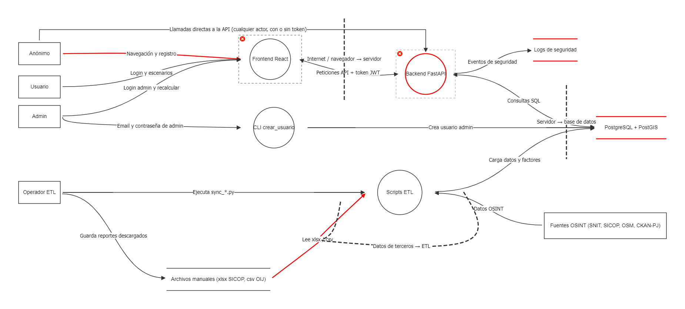

# Modelo de amenazas (STRIDE)

Este documento corresponde al ítem 1.3. Usé **OWASP Threat Dragon** para dibujar
cómo se mueven los datos en la aplicación y buscar qué podría salir mal en cada parte.

Me enfoqué en los flujos críticos que están en [autenticacion.md](autenticacion.md):

- **F1:** registro e inicio de sesión
- **F2:** recalcular el índice de viabilidad (solo el admin)
- **F3:** escenarios privados de cada usuario

También agregué el **ETL**, porque es lo que carga los datos que después usa el índice.

## Archivos

| Archivo | Para qué sirve |
|---|---|
| [eco-inversion.json](threat-model/eco-inversion.json) | El modelo. Se abre con Threat Dragon. |
| [diagrama-flujos.png](threat-model/diagrama-flujos.png) | Imagen del diagrama. |
| [reporte-amenazas.pdf](threat-model/reporte-amenazas.pdf) | Reporte que genera Threat Dragon con las 11 amenazas. |

En el diagrama, lo que está en **rojo** tiene amenazas **abiertas**. Lo que ya tiene
un control (estado *Mitigated*) se ve en negro.

La flecha "Llamadas directas a la API" sale de Anónimo, pero vale para los tres
actores: Usuario y Admin también pueden llamar a la API sin pasar por el frontend
(curl, Swagger, scripts). Se dibujó una sola para no saturar el diagrama.

## ¿Qué es STRIDE?

Es una lista de 6 tipos de ataque. A cada amenaza le pusimos la letra que le corresponde:

| Letra | Significa | Qué rompe |
|---|---|---|
| **S** | Spoofing (suplantar) | Hacerse pasar por otra persona |
| **T** | Tampering (alterar) | Cambiar datos sin permiso |
| **R** | Repudiation (negar) | Negar que uno hizo algo y que no se pueda probar |
| **I** | Information disclosure (filtrar) | Ver información que no le toca |
| **D** | Denial of service (bloquear) | Dejar el sistema o una cuenta sin servicio |
| **E** | Elevation of privilege (subir permisos) | Hacer cosas de admin sin serlo |

## Fronteras de confianza

Son las líneas punteadas del diagrama. Marcan dónde los datos pasan de un lugar
en el que no confiamos a uno en el que sí. Ahí es donde más hay que revisar.

| Frontera | Qué separa |
|---|---|
| **B1** Internet / navegador → servidor | El navegador del usuario (no lo controlamos) del backend |
| **B2** Servidor → base de datos | El backend de la base de datos, que tiene lo más importante |
| **B3** Datos de terceros → ETL | Los archivos y páginas externas de los que sacamos datos |

## ¿Cómo decidimos la prioridad?

A cada amenaza le dimos dos notas del 1 al 3:

- **Probabilidad (P):** qué tan fácil o común es que pase.
- **Impacto (I):** qué tan grave sería si pasa.

Después las multiplicamos:

| P × I | Prioridad |
|---|---|
| 7 a 9 | Alta |
| 4 a 6 | Media |
| 1 a 3 | Baja |

**Ojo:** como las dos notas van de 1 a 3, el resultado solo puede ser 1, 2, 3, 4, 6
o 9. Nunca da 7 ni 8, así que en la práctica **Alta es solo 9**: probabilidad alta
**y** impacto alto. Lo dejamos así a propósito, para que "Alta" quede para lo más
urgente. Por eso T-03 (token falso de admin) queda en Media: el impacto es alto (3),
pero primero tiene que filtrarse la clave, así que la probabilidad es 2.

## Amenazas encontradas

| ID | ¿Qué podría pasar? | STRIDE | ¿Dónde? | P × I | Prioridad | Estado |
|---|---|---|---|---|---|---|
| T-01 | La base de datos tiene el puerto 5432 abierto y la contraseña por defecto es `changeme`. Alguien podría entrar directo. | I | PostgreSQL | 3 × 3 = 9 | **Alta** | Abierta |
| T-02 | Alguien cambia un archivo de SICOP/OIJ o una fuente externa y el ETL carga datos falsos. | T | Lee xlsx / csv | 2 × 3 = 6 | Media | Abierta |
| T-03 | Si se filtra la clave secreta del JWT, alguien puede crear un token falso, incluso de admin. | S | Backend | 2 × 3 = 6 | Media | Abierta |
| T-04 | Prueban correos y contraseñas filtrados de otras páginas (credential stuffing). Solo hay bloqueo por cuenta, no por IP. | S | Backend | 3 × 2 = 6 | Media | Abierta |
| T-05 | Alguien falla el login a propósito con el correo de otra persona para bloquearle la cuenta. | D | Backend | 3 × 2 = 6 | Media | Abierta |
| T-06 | No hay límite de peticiones; muchas peticiones a los mapas podrían poner lento o botar el backend. | D | Backend | 2 × 2 = 4 | Media | Abierta |
| T-07 | Los logs se pueden borrar o perder, y después no se puede probar quién hizo algo. | R | Logs de seguridad | 2 × 2 = 4 | Media | Abierta |
| T-08 | Si roban un token, sirve hasta que vence (30 min). No hay cierre de sesión del lado del servidor. | S | Backend | 2 × 2 = 4 | Media | Abierta |
| T-09 | Un usuario cambia el id en la URL para ver escenarios de otro (IDOR). | I | Peticiones API | 1 × 3 = 3 | Baja | **Mitigada** |
| T-10 | Al registrarse, la API dice si un correo ya existe, así se puede saber quién tiene cuenta. | I | Registro | 3 × 1 = 3 | Baja | Abierta |
| T-11 | Un usuario normal intenta hacer cosas de admin: recalcular el índice o registrarse con `"rol": "admin"`. | E | Backend (flujo F2) | 1 × 3 = 3 | Baja | **Mitigada** |

Cada amenaza tiene su explicación completa (recurso, impacto y por qué esa
prioridad) dentro del modelo de Threat Dragon y en el PDF.

### Algunas notas

- **La más importante es T-01**, porque se puede atacar sin pasar por la aplicación.
- **T-03 también es E**, porque con un token falso de admin se pueden hacer cosas de admin.
  Threat Dragon solo deja escoger una letra, por eso quedó como S.
- **T-10 ayuda a T-04 y T-05:** primero averiguan qué correos existen y luego los atacan.
- **T-09 y T-11 están mitigadas:** el código ya tiene un control y hay pruebas que lo
  comprueban. T-09: `_obtener_propio` en `backend/app/routers/escenarios.py` responde 404
  si el escenario no es del usuario. T-11: `requiere_admin` en `backend/app/auth.py`
  responde 403 y el registro rechaza el campo `rol` con 422. Las dejamos en la lista
  para que se vea que sí se revisaron.
- **T-11 está en el Backend y no en la flecha del flujo F2** porque en Threat Dragon
  las flechas solo permiten T, I o D. La E solo se puede poner en un proceso, y el
  Backend es quien decide si alguien es admin.
- Con T-11 cada letra de STRIDE tiene al menos una amenaza, y los tres flujos
  críticos (F1, F2 y F3) tienen amenazas propias.
- Las amenazas abiertas quedan registradas para que el equipo decida si se corrigen;
  este ítem solo pide identificarlas y priorizarlas.

## Cambios después de la revisión

Karina revisó el PR del modelo y pidió dos cambios: agregar una amenaza para el
flujo F2 y de tipo E (ahora es T-11), y que T-09 quedara como mitigada en Threat
Dragon. También sugirió explicar la regla de prioridad, corregir la frase de T-08
sobre el cierre de sesión y ajustar el diagrama. Se hicieron todos.

## Uso de IA

Usé un asistente de IA (Claude) para que me propusiera los flujos del diagrama,
las fronteras y una primera lista de amenazas. La IA también agregó las flechas y
las fronteras al archivo del modelo. Yo puse los elementos en Threat Dragon,
revisé y acomodé las flechas y fronteras, revisé cada amenaza contra el código
y contra `autenticacion.md`, las ingresé en Threat Dragon y les puse la prioridad
con la regla P × I.
