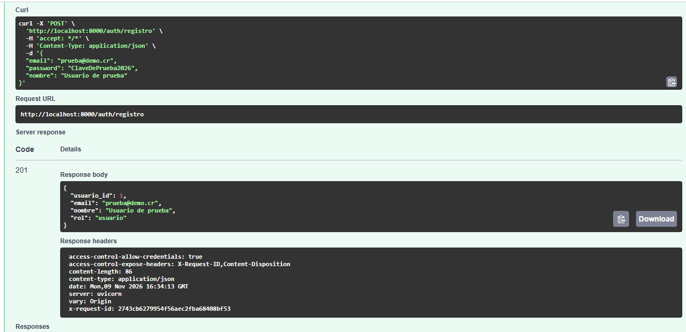
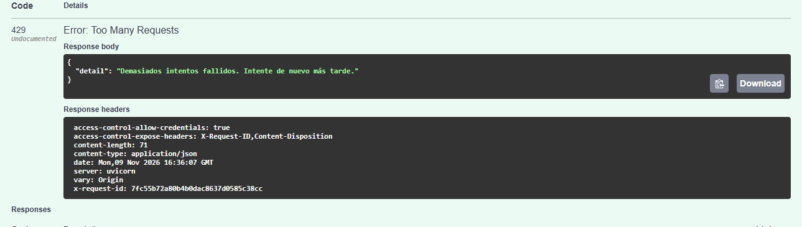
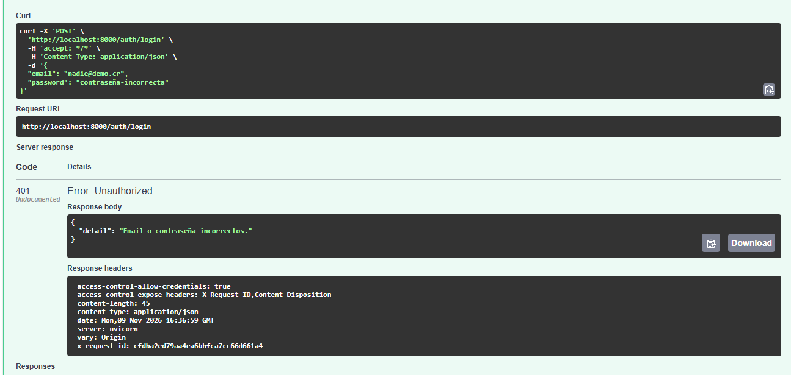

# Revisión de código asistida por IA (ítem 2.6)

En este ítem usé un asistente de IA (Claude) para revisar Pull Requests y buscar
defectos, problemas de seguridad y pruebas que faltan. **La IA no decide nada:** cada
hallazgo se deja como comentario en la línea exacta del código y la persona dueña
del código decide si lo corrige, si no aplica o si se deja para después.

La IA tampoco aprueba el PR. Eso lo siguen haciendo los checks obligatorios del CI
(Backend, Frontend, Seguridad y Políticas, y el DAST cuando corre) y la revisión de
otro integrante del equipo.

## Qué PR revisé

| Revisión | PR | Autor/a | Hallazgos | Resultado |
|---|---|---|---|---|
| **Principal** | [#22 Ítem 3.4: políticas de contenedores](https://github.com/elein06/eco-inversion-cr/pull/22) | @elein06 | 7 | Todos decididos. Aprobado y fusionado |
| **Principal** | [#26 Ítems 5.5 y 6.1: Docker Hub y Render](https://github.com/elein06/eco-inversion-cr/pull/26) | @elein06 | 5 | Todos decididos. Aprobado y fusionado |
| Práctica | [#10 Autenticación, roles y escenarios privados](https://github.com/elein06/eco-inversion-cr/pull/10) | @KarinaMD16 | 7 | Todos respondidos por Karina |

En el equipo acordamos que yo reviso los PR de Elein. Antes de que ella abriera los
suyos, probé el proceso con el PR #10 de Karina, porque tiene el código de los flujos
críticos de mi modelo de amenazas (login y escenarios privados).

## Cómo lo hice (el proceso)

1. **Darle contexto a la IA.** No le pedí solo "revisa este código". Le di el PR, los
   requisitos (los ítems o documentos que el PR dice cumplir) y los riesgos
   ([amenazas.md](amenazas.md), ítem 1.3), para que revisara contra lo que el sistema
   **debe** hacer.
2. **Revisar lo que propuso la IA.** Leí cada hallazgo contra el código antes de
   publicarlo. Si algo dependía de una decisión del equipo (por ejemplo, permisos),
   no se asumió la respuesta: quedó como **DUDA**.
3. **Comentar en el PR.** Cada hallazgo quedó como comentario en su línea (pestaña
   *Files changed*), con ubicación, justificación, comprobación sugerida y severidad.
   Al terminar elegí **Request changes**, nunca *Approve*.
4. **Otra persona decide.** El autor del PR responde en el mismo hilo:
   ✅ lo corrige, ❌ no aplica (con la razón) o 📌 se deja para después.
5. **Verificar.** Revisé en el código que las correcciones fueran reales y esperé a que
   el CI terminara en verde.
6. **Aprobar.** Solo entonces aprobé, con un comentario que resume qué verifiqué. El
   merge lo hace el autor.

### Prompt que se usa

Para cada PR solo cambian las partes de "CAMBIO A REVISAR", "REQUISITOS" y "RIESGOS".
Este es el del PR #10:

```text
Actúa como revisor de código de seguridad para el repositorio eco-inversion-cr.

CAMBIO A REVISAR
- PR #10 "Autenticación, roles y escenarios privados con pruebas" (commit da38b30), comparado contra su rama base.

REQUISITOS (cómo debe comportarse)
- docs/autenticacion.md: flujos F1 (autenticación), F2 (recalcular índice, solo admin) y F3 (escenarios privados), roles, reglas de acceso, criterios de aceptación y controles.

RIESGOS (qué puede salir mal)
- Modelo de amenazas del ítem 1.3: docs/amenazas.md, amenazas T-01 a T-10.

QUÉ BUSCAR
1. Defectos: el código no cumple un requisito o un criterio de aceptación.
2. Problemas de seguridad: relacionados con las amenazas T-01 a T-10 u otros que encuentres.
3. Pruebas faltantes: comportamientos importantes sin prueba en backend/tests.

FORMATO DE CADA HALLAZGO
- ID (H-01, H-02…), título corto y tipo (defecto / seguridad / prueba faltante)
- Ubicación: archivo y línea
- Justificación: qué requisito o amenaza (T-xx) afecta y por qué
- Comprobación sugerida: cómo verificar si el hallazgo es real
- ¿Hay una prueba existente que lo cubra? (sí/no y cuál)
- Severidad: alta / media / baja

REGLAS
- Máximo 8 hallazgos, los más importantes.
- Si algo depende de una decisión del equipo (permisos o comportamiento esperado), no asumas la respuesta: anótalo como DUDA con la persona que debería responderla.
- No apruebes el cambio. Tu revisión no reemplaza el CI ni la revisión humana; la decisión sobre cada hallazgo la toma otro integrante.
```

En el #22 los requisitos fueron los ítems 3.4 y 2.5, y en el #26 los ítems 5.5, 6.1,
5.2 y 2.5. Los riesgos siempre fueron las amenazas de [amenazas.md](amenazas.md).

---

## Revisión principal 1: PR #22 (políticas de contenedores)

- **PR:** [#22](https://github.com/elein06/eco-inversion-cr/pull/22), revisado contra
  los ítems 3.4 y 2.5 (los cambios en reglas y scripts de verificación los revisa otro
  integrante).
- **Quién decide:** @elein06, autora del PR. En H-07 también decidió @Orlando0409,
  responsable de `docker-compose.seguridad.yml`.

| ID | Hallazgo | Tipo | Severidad | Comentario | Decisión |
|---|---|---|---|---|---|
| H-01 | Las excepciones usaban el comodín `"*"` y cubrían cualquier servicio del archivo | Seguridad | Media | [ver](https://github.com/elein06/eco-inversion-cr/pull/22#discussion_r4532480116) | ✅ Elein: lista explícita de servicios (`a436327`) |
| H-02 | La regla U2 aceptaba un `user` con variables, que puede terminar en root | Seguridad | Media | [ver](https://github.com/elein06/eco-inversion-cr/pull/22#discussion_r4532485244) | ✅ Elein: U2 rechaza `user` con variables |
| H-03 | EXC-01 no estaba enlazada al registro de hallazgos | Defecto | Baja | [ver](https://github.com/elein06/eco-inversion-cr/pull/22#discussion_r4532495386) | ✅ Elein: creó el Issue #23 y lo enlazó |
| H-04 | La fecha de vencimiento se leía como 00:00 UTC y vencía un día antes en Costa Rica | Defecto | Baja | [ver](https://github.com/elein06/eco-inversion-cr/pull/22#discussion_r4532499847) | ✅ Elein: vence a las 23:59:59 hora de Costa Rica |
| H-05 | Faltaban pruebas de las reglas | Prueba faltante | Baja | [ver](https://github.com/elein06/eco-inversion-cr/pull/22#discussion_r4532503386) | ✅ Elein: 6 pruebas nuevas |
| H-06 | DUDA: ¿el check de Políticas bloquea el merge? | Duda | — | [ver](https://github.com/elein06/eco-inversion-cr/pull/22#discussion_r4532506751) | ✅ Elein: es obligatorio en `development` y `main` |
| H-07 | DUDA: la autora aprobaba su propia excepción EXC-01 | Duda | — | [ver](https://github.com/elein06/eco-inversion-cr/pull/22#discussion_r4532513626) | 📌 Orlando no la aprobó y la corrigió en el #24; se retiró en el #25 |

### Cómo se cerró H-07

EXC-01 dejaba correr los escáneres de seguridad como root, y la había aprobado la
misma autora. Elein dejó la aprobación pendiente y Orlando, responsable del archivo,
no la aprobó: corrigió el problema de fondo en el
[PR #24](https://github.com/elein06/eco-inversion-cr/pull/24) (los escáneres corren con
el usuario 1001).

El #24 no podía fusionarse sin el check de Políticas, y ese workflow venía en el #22.
Por eso aprobé el #22 con EXC-01 **solo como excepción temporal** y lo dejé escrito en
mi aprobación. Después Elein abrió el
[PR #25 "Retira EXC-01"](https://github.com/elein06/eco-inversion-cr/pull/25), que borra
la excepción y corrige la documentación. Lo aprobé cuando el check de Políticas
confirmó que, sin la excepción, no falla nada.

---

## Revisión principal 2: PR #26 (Docker Hub y Render)

- **PR:** [#26](https://github.com/elein06/eco-inversion-cr/pull/26), revisado contra
  los ítems 5.5, 6.1, 5.2 y 2.5.
- **Quién decide:** @elein06, autora del PR. En H-02 también decidió @KarinaMD16,
  responsable del DAST (ítem 4.7).

| ID | Hallazgo | Tipo | Severidad | Comentario | Decisión |
|---|---|---|---|---|---|
| H-01 | Las ramas `demo/**` podían publicar imágenes en Docker Hub sin revisión | Seguridad | Media | [ver](https://github.com/elein06/eco-inversion-cr/pull/26#discussion_r4542821896) | ✅ Elein: solo publica `development`, con el token en un environment restringido (`490ddff`) |
| H-02 | DUDA: ¿el DAST debe correr antes de publicar? | Duda | Media | [ver](https://github.com/elein06/eco-inversion-cr/pull/26#discussion_r4542827125) | 📌 Elein y Karina: queda como check de PR y quien revisa comprueba que esté en verde |
| H-03 | El tiempo máximo del job no alcanzaba para esperar los dos servicios | Defecto | Baja | [ver](https://github.com/elein06/eco-inversion-cr/pull/26#discussion_r4542830196) | ✅ Elein: 10 min por servicio y timeout de 30 |
| H-04 | `/health` muestra en público el commit exacto | Seguridad | Baja | [ver](https://github.com/elein06/eco-inversion-cr/pull/26#discussion_r4542834380) | ❌ Elein: riesgo aceptado y documentado (STRIDE I) |
| H-05 | La imagen final no se escanea por vulnerabilidades | Prueba faltante | Baja | [ver](https://github.com/elein06/eco-inversion-cr/pull/26#discussion_r4542836171) | ❌ Elein: corresponde al ítem 3.3, que el equipo no eligió |

Antes de aprobar verifiqué en el código las correcciones (`490ddff`) y esperé el CI
completo. Los checks se quedaron trabados por un incidente de GitHub Actions y Elein
los relanzó. Como en H-02 se acordó que quien revisa comprueba que el DAST esté en
verde, esperé a que ZAP (DAST) terminara y aprobé el 11 de noviembre sobre el commit
`99f541b`, con Backend, Frontend, Seguridad, Políticas y DAST en verde.

---

## Revisión de práctica: PR #10 (Karina)

- **PR:** [#10](https://github.com/elein06/eco-inversion-cr/pull/10), commit `da38b30`.
- **Quién decide:** @KarinaMD16, autora del PR y dueña del requisito.
- **Nota:** el PR #10 ya estaba fusionado cuando lo revisé. Por eso lo que se decida
  corregir va en un PR nuevo o en un Issue.

| ID | Hallazgo | Tipo | Ubicación | Severidad | Comentario | Decisión de Karina |
|---|---|---|---|---|---|---|
| H-01 | El login revela si una cuenta existe: la que existe se bloquea (429) y la que no existe siempre da 401 | Seguridad | `backend/app/routers/auth.py:116` | Media | [ver](https://github.com/elein06/eco-inversion-cr/pull/10#discussion_r4515852342) | 📌 Aceptado como limitación: es real, pero corregirlo no da tiempo; la misma fuga ya existe en el registro (T-10). Hay que corregir `docs/autenticacion.md` |
| H-02 | No hay pruebas de que el contador de fallos se reinicie ni de que el bloqueo venza | Prueba faltante | `backend/app/routers/auth.py:121` | Media | [ver](https://github.com/elein06/eco-inversion-cr/pull/10#discussion_r4515860051) | 📌 Pendiente: faltan las dos pruebas; el bloqueo en sí ya está probado |
| H-03 | DUDA: ¿el admin puede ver escenarios de otros usuarios? | Duda (permisos) | `docs/autenticacion.md:38` | — | [ver](https://github.com/elein06/eco-inversion-cr/pull/10#discussion_r4515932306) · Issue [#15](https://github.com/elein06/eco-inversion-cr/issues/15) | Decidido en #15: se mantiene, el admin recibe 404 |
| H-04 | DUDA: volver a correr `crear_usuario` cambia el rol y reactiva la cuenta | Duda (permisos) | `backend/app/crear_usuario.py:45` | — | [ver](https://github.com/elein06/eco-inversion-cr/pull/10#discussion_r4515956167) · Issue [#16](https://github.com/elein06/eco-inversion-cr/issues/16) | Decidido en #16: es intencional (promover o restablecer cuentas) |
| H-05 | DUDA: no hay límite de escenarios por usuario | Duda / seguridad | `backend/app/routers/escenarios.py:167` | Baja | [ver](https://github.com/elein06/eco-inversion-cr/pull/10#discussion_r4515964046) · Issue [#20](https://github.com/elein06/eco-inversion-cr/issues/20) | Decidido en #20: riesgo aceptado, se retoma con T-06 |
| H-06 | Si el escenario se borra a mitad de una actualización, responde 500 en vez de 404 | Defecto | `backend/app/routers/escenarios.py:231` | Baja | [ver](https://github.com/elein06/eco-inversion-cr/pull/10#discussion_r4515969014) | 📌 Pendiente: es real pero poco probable y no expone datos; falta responder 404 |
| H-07 | Detrás de un proxy, todos los eventos de seguridad guardarían la IP del proxy | Seguridad | `backend/app/eventos.py:52` | Baja | [ver](https://github.com/elein06/eco-inversion-cr/pull/10#discussion_r4516008970) | 📌 Ahora aplica porque el backend está en Render detrás de su proxy; se corrige con `--forwarded-allow-ips` y lo coordina con Elein |

H-03, H-04 y H-05 también salieron en el ítem 1.6 (casos de abuso), por eso tienen
su Issue. Son la misma duda vista desde el código y desde las reglas.

### Comprobación de H-01 en la API

Lo probé yo misma en Swagger (`http://localhost:8000/docs`) el 9-nov-2026:

1. Creé una cuenta de prueba → `201`.
   
2. Hice 6 logins con contraseña incorrecta en esa cuenta → el sexto respondió
   `429` (cuenta bloqueada).
   
3. Hice 25 logins con un correo que **no** existe → siempre respondió `401`.
   

**Resultado:** el hallazgo es real. Con 6 intentos se puede saber si un correo tiene
cuenta, aunque `docs/autenticacion.md` dice que el login no lo revela. Los eventos
de seguridad del backend quedaron en [h01-logs.txt](revision-ia/h01-logs.txt)
(request-id `7fc55b72…` para el 429 y `cfdba2ed…` para el 401). En el log no
aparecen contraseñas ni tokens, y el correo de la cuenta inexistente sale como hash.

---

## Por qué la IA no sustituye la revisión humana

- En el #22 la IA no sabía que el #24 dependía del check que traía el #22. Esa
  dependencia la detectó Elein, y por eso cambiamos el plan para EXC-01.
- No todo hallazgo se corrige. En el #26 Elein rechazó H-04 y H-05 con razones
  válidas; esa decisión le corresponde a ella, no a la IA ni a mí.
- Nunca aprobé con el CI incompleto: en el #26 esperé a que terminara el DAST.
- Las dudas (H-06 y H-07 del #22, H-02 del #26) las resolvieron personas: Elein,
  Orlando y Karina.

## Qué hizo la IA y qué hice yo

| La IA | Yo |
|---|---|
| Propuso los hallazgos a partir del prompt | Escribí el prompt con los requisitos y las amenazas |
| Sugirió la ubicación, la justificación y cómo comprobarlos | Revisé cada hallazgo contra el código antes de publicarlo |
| Ayudó a redactar los comentarios | Hice la prueba de H-01 en Swagger y guardé la evidencia |
| — | Publiqué los comentarios, verifiqué las correcciones y el CI, y decidí cuándo aprobar |

La decisión final de cada hallazgo **no** es mía ni de la IA: es del autor del PR.
